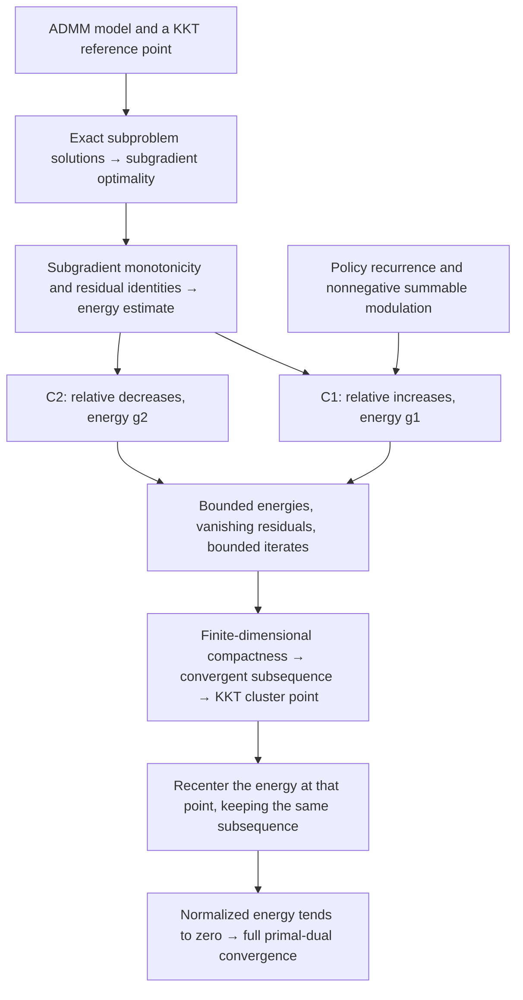

# Adaptive ADMM in Lean

[简体中文](README.md) | English

A Lean library for convergence of two-block ADMM with a variable scalar penalty. It contains the C1 and C2 convergence proofs and a reusable interface for summable increase/decrease/keep policies.

## Build and import

The project pins Lean and mathlib to `v4.24.0-rc1`. With elan installed, run from this directory:

```bash
lake exe cache get
lake build
```

The default build includes the public entry point, all AdaptiveADMM modules, and their supporting mathematics. Import the library with:

```lean
import Optlib.Algorithm.AdaptiveADMM

#check AdaptiveADMM_Convergence_Proof.adaptive_admm_convergence_c1
#check AdaptiveADMM_Convergence_Proof.adaptive_admm_convergence
#check Strategy3.converges_from_policy
#check KKTPoint
```

The unsuffixed `adaptive_admm_convergence` is the C2 theorem. Existing imports of individual modules remain available. `Optlib.lean` belongs to the broader upstream library; use the AdaptiveADMM entry point above for this project.

To check a proof that imports the library:

```bash
lake env lean -E hasSorry -DautoImplicit=false -DrelaxedAutoImplicit=false MyProof.lean
```

## Mathematical scope

The problem is `min f₁(x₁) + f₂(x₂)` subject to `A₁ x₁ + A₂ x₂ = b`, in finite-dimensional real inner-product spaces. The full convergence theorems assume:

- Lower-semicontinuous, convex, everywhere finite real-valued objectives and an existing KKT point.
- Exact minimization of both ADMM subproblems.
- Injective `A₁` and `A₂`.
- A penalty sequence bounded above and bounded away from zero.
- Fixed multiplier relaxation `0 < τ < (1 + sqrt 5) / 2`.
- The relative-penalty variation condition C1 or C2.

`Strategy3.converges_from_policy` derives C1 from a nonnegative summable modulation sequence and the stated three-action recurrence. Clipping uses the effective modulation along the actual penalty sequence. A concrete candidate must establish its parameters, recurrence, and problem assumptions; the generic theorem does not establish Python-to-Lean correspondence.

## Formal proof framework

The proof has three parts: a shared energy estimate, convergence under C1 or C2, and the connection to concrete penalty policies. The diagram shows the mathematical dependencies under the model assumptions above.



### 1. From the iteration to an energy estimate

[`AdaptiveScheme.lean`](Optlib/Algorithm/AdaptiveADMM/AdaptiveScheme.lean) updates $x_1^{n+1}$, then $x_2^{n+1}$, then $y^{n+1}$. Both subproblems use $\rho_{n+1}$, and the second uses the newly updated $x_1^{n+1}$. The multiplier satisfies

$$
r_n=A_1x_1^n+A_2x_2^n-b,
\qquad y^{n+1}=y^n+\tau\rho_{n+1}r_{n+1}.
$$

Fix `reference : KKTPoint admm` with components $(\bar x_1,\bar x_2,\bar y)$, and write $e_{i,n}=x_i^n-\bar x_i$ and $e_{y,n}=y^n-\bar y$. [`AdaptiveDefinitions.lean`](Optlib/Algorithm/AdaptiveADMM/AdaptiveDefinitions.lean) defines two energies:

$$
\begin{aligned}
T&=2-\tfrac12(1+\tau-\tau^2),\\
g_{1,n}&=\|e_{y,n}\|^2+\tau\rho_n^2\|A_2e_{2,n}\|^2
         +\tau(T-\tau)\rho_n^2\|r_n\|^2,\\
g_{2,n}&=\rho_n^{-2}g_{1,n}.
\end{aligned}
$$

[`AdaptiveOptimality.lean`](Optlib/Algorithm/AdaptiveADMM/AdaptiveOptimality.lean) turns exact minimization into subgradient inclusions. [`AdaptiveEnergyIdentities.lean`](Optlib/Algorithm/AdaptiveADMM/AdaptiveEnergyIdentities.lean) and [`AdaptiveEnergyDescent.lean`](Optlib/Algorithm/AdaptiveADMM/AdaptiveEnergyDescent.lean) use subgradient monotonicity, the multiplier update, and cross-term estimates to prove the common descent theorem `HWY_Theorem_3_1`. This part does not yet require C1 or C2.

### 2. What C1 and C2 control

Write $[t]_+=\max\{t,0\}$. For $n\ge1$, the two routes differ as follows:

| Route | Penalty variation | Energy | Lean condition |
| --- | --- | --- | --- |
| C1 | $\eta_n^2=[(\rho_{n+1}/\rho_n)^2-1]_+$, controlling relative increases | $g_{1,n}$ | [`Condition_C1`](Optlib/Algorithm/AdaptiveADMM/AdaptiveCondition1.lean) |
| C2 | $\theta_n^2=[(\rho_n/\rho_{n+1})^2-1]_+$, controlling relative decreases | $g_{2,n}$ | [`Condition_C2`](Optlib/Algorithm/AdaptiveADMM/AdaptiveCondition2.lean) |

The code sets $\eta_0=0$; $\theta_0$ still follows the formula above. C1 requires $\sum_n\eta_n^2<\infty$, and C2 requires $\sum_n\theta_n^2<\infty$. Both Lean conditions also explicitly store convergence and a finite upper bound for the corresponding infinite product, $\prod_n(1+\eta_n^2)$ or $\prod_n(1+\theta_n^2)$. These conditions concern only the penalty sequence and are independent of the chosen KKT reference.

Set

$$
D_{n+1}=\|r_{n+1}\|^2+\|A_2(x_2^{n+1}-x_2^n)\|^2,
\qquad c=\tfrac13\tau(1+\tau-\tau^2)>0.
$$

The common estimate gives the following two inequalities, both for $n\ge1$:

$$
\begin{aligned}
g_{1,n+1}+c\rho_{n+1}^2D_{n+1}&\le(1+\eta_n^2)g_{1,n},\\
g_{2,n+1}+cD_{n+1}&\le(1+\theta_n^2)g_{2,n}.
\end{aligned}
$$

These are `HWY_ineq_51` and `HWY_ineq_56_0'`. Bounded energies, summable dissipation, and the positive lower bound on the penalty yield $r_n\to0$ and $A_2(x_2^{n+1}-x_2^n)\to0$ in both routes. The corresponding summary theorems are `HWY_Convergence_1` and `HWY_Convergence_2`.

### 3. From a KKT cluster point to full-sequence convergence

1. **Extract a convergent subsequence.** [`BoundednessC1.lean`](Optlib/Algorithm/AdaptiveADMM/BoundednessC1.lean) and [`BoundednessC2.lean`](Optlib/Algorithm/AdaptiveADMM/BoundednessC2.lean) combine the energy bounds, the two-sided penalty bounds, and injectivity of $A_1,A_2$ to show that $(x_1^n,x_2^n,y^n)$ is bounded. Finite-dimensional compactness provides a common subsequence with limit $(x_1^*,x_2^*,y^*)$.
2. **Show that the limit is KKT.** [`ClusterPointC1.lean`](Optlib/Algorithm/AdaptiveADMM/ClusterPointC1.lean) and [`ClusterPointC2.lean`](Optlib/Algorithm/AdaptiveADMM/ClusterPointC2.lean) obtain feasibility from the vanishing residual. Passing to the limit in the subgradient inclusions and using the closed subgradient graph gives $-A_i^*y^*\in\partial f_i(x_i^*)$. Together, these facts define a new `limitKKT : KKTPoint admm`.
3. **Recenter the energy at the cluster point.** Keep the selected subsequence and change the error reference to `limitKKT`. The corresponding energy then tends to zero along that subsequence. With $E_n$ denoting this energy and $a_n$ denoting $\eta_n^2$ or $\theta_n^2$, define

   $$
   Q_n=\prod_{k=0}^{n-1}(1+a_k),\qquad \widehat E_n=E_n/Q_n.
   $$

   The sequence $Q_n$ converges to a finite positive number. The normalized energy $\widehat E_n$ is nonnegative, nonincreasing from $n=1$ onward, and has a subsequence tending to zero. The lemma `tendsto_zero_of_antitone_tail_of_subseq` in [`SequenceConvergence.lean`](Optlib/Algorithm/AdaptiveADMM/SequenceConvergence.lean) therefore gives $\widehat E_n\to0$, and hence $E_n\to0$.
4. **Recover convergence of each variable.** Vanishing energy gives $e_{y,n}\to0$ and $A_2e_{2,n}\to0$. The identity $A_1e_{1,n}=r_n-A_2e_{2,n}$ gives $A_1e_{1,n}\to0$. The inverse norm bounds for injective linear maps in finite-dimensional spaces then give $e_{1,n},e_{2,n}\to0$.

The conclusion is that **there exists a KKT point whose components are the limits of the two primal sequences and the multiplier sequence**. The initial `reference` starts the estimates; the limit need not equal that initial reference point.

| Final theorem (namespace `AdaptiveADMM_Convergence_Proof`) | Source |
| --- | --- |
| `adaptive_admm_convergence_c1` | [Full convergence under C1](Optlib/Algorithm/AdaptiveADMM/AdaptiveTheorem_converge_c1.lean) |
| `adaptive_admm_convergence` | [Full convergence under C2](Optlib/Algorithm/AdaptiveADMM/AdaptiveTheorem_converge_c2.lean) |

### 4. Connecting a concrete policy

The policy interface uses a nonnegative summable modulation $\delta_n$ and proves that the actual penalty satisfies

$$
\rho_{n+1}\in\{\rho_n(1+\delta_n),\ \rho_n/(1+\delta_n),\ \rho_n\}.
$$

Here $\delta_n$ is distinct from the fixed multiplier relaxation $\tau$; its code field is named `tau_seq` or `policy.tau.seq`. [`Adaptive_Strategy_Convergence.lean`](Optlib/Algorithm/AdaptiveADMM/Strategies/Adaptive_Strategy_Convergence.lean) first proves $\eta_n^2\le2\delta_n+\delta_n^2$, uses $\sum_n\delta_n<\infty$ to establish the C1 series and product conditions, and applies `adaptive_admm_convergence_c1`. A concrete template supplies the modulation, actual recurrence, and problem assumptions, reusing the boundedness and full convergence proofs. See the [proof templates](examples/README.md) for examples.

## Explicit reference points

`KKTPoint admm` stores a primal-dual point and its KKT proof. Errors and energies take that point as an ordinary argument: `e₁ admm reference n`, `ey admm reference n`, and `g1 admm reference n`. `Condition_C1 admm` and `Condition_C2 admm` concern only the penalty sequence.

The convergence proofs pass the original reference to the boundedness and subsequence construction. They then pass the resulting `limitKKT` to the final error and energy estimates, keeping the selected subsequence fixed. Core proofs do not use `Setting` or infer a reference point through typeclass search.

`Compatibility.lean` retains the old `Existance_of_kkt` spelling and empty `Setting` parameter for older proofs. New proofs should use `KKTPoint` and the explicit arguments above.

## Source organization

All paths below are relative to `Optlib/Algorithm/AdaptiveADMM/`.

| Module | Responsibility |
| --- | --- |
| `AdaptiveScheme.lean` | Problem, iteration, KKT relation, and `KKTPoint` |
| `AdaptiveDefinitions.lean` | Errors, energies, and auxiliary sequences with explicit arguments |
| `AdaptiveOptimality.lean` | Subproblem convexity, differentiation, and subgradient membership |
| `AdaptiveEnergyIdentities.lean` | Residual identities and subgradient monotonicity estimates |
| `AdaptiveEnergyDescent.lean` | Cross-term bounds and the common energy decrease inequality |
| `AdaptiveLemmas.lean` | Import entry point for the common optimality and descent results |
| `AdaptiveCondition1.lean`, `AdaptiveCondition2.lean` | Penalty variation, energy bounds, and vanishing residuals |
| `BoundednessC1.lean`, `BoundednessC2.lean` | Product normalization, bounded trajectories, and subsequence selection |
| `ClusterPointC1.lean`, `ClusterPointC2.lean` | Subsequence limits and construction of the KKT cluster point |
| `AdaptiveTheorem_converge_c1.lean`, `AdaptiveTheorem_converge_c2.lean` | Recentered energy and convergence of the full sequence |
| `SequenceConvergence.lean` | Shared scalar argument from a zero subsequence to a zero limit |
| `AdaptiveProductBounds.lean`, `AdaptiveInv_bounded.lean` | Product estimates and bounds for injective linear maps |
| `Strategies.lean`, `Strategies/` | Policies, summable modulation sequences, clipping, and the C1 connection |

The supporting `Optlib/Convex`, `Optlib/Differential`, `Optlib/Function`, and `Optlib/Optimality` modules supply the reused mathematics. See the [strategy guide](Optlib/Algorithm/AdaptiveADMM/Strategies/README.md) for the policy interface.

## License

The project retains the upstream [Apache 2.0 license](LICENSE.txt) and source author notices.
