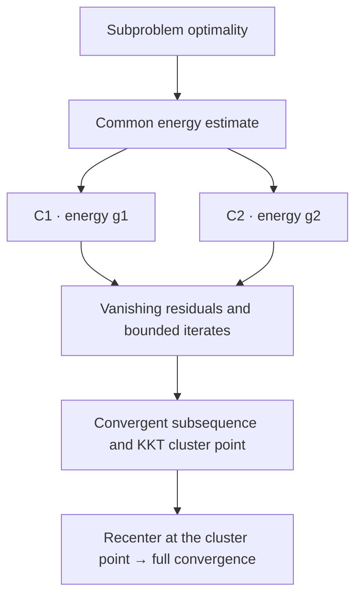

# Adaptive ADMM in Lean

[简体中文](README.md) · [Results](#mathematical-results) · [Proof framework](#formal-proof-framework) · [Usage](#usage) · [Source guide](#source-guide)

This Lean 4 library proves convergence of two-block ADMM with a variable penalty. It provides the C1 and C2 proof routes and reusable interfaces for concrete penalty policies.

## Mathematical results

In finite-dimensional real inner-product spaces, consider

$$
\min_{x_1,x_2}\ f_1(x_1)+f_2(x_2)
\quad\text{s.t.}\quad A_1x_1+A_2x_2=b.
$$

The full convergence theorems assume:

- Lower-semicontinuous, convex, everywhere finite real-valued $f_1,f_2$, and an existing KKT point.
- Exact solution of both subproblems at every iteration, in the order $x_1\to x_2\to y$.
- Injective $A_1,A_2$; for matrices, this means full column rank.
- $0<\underline\rho\le\rho_n\le\overline\rho<\infty$.
- Fixed multiplier relaxation $0<\tau<(1+\sqrt5)/2$.
- Either C1 or C2 below for the penalty variation.

**Conclusion: there is a KKT point $(x_1^*,x_2^*,y^*)$ such that $x_1^n\to x_1^*$, $x_2^n\to x_2^*$, and $y^n\to y^*$.**

| Route | Penalty requirement | Convergence theorem |
| --- | --- | --- |
| C1 | Summable relative increases $\eta_n^2$, with a convergent and bounded corresponding product | [`adaptive_admm_convergence_c1`](Optlib/Algorithm/AdaptiveADMM/AdaptiveTheorem_converge_c1.lean) |
| C2 | Summable relative decreases $\theta_n^2$, with a convergent and bounded corresponding product | [`adaptive_admm_convergence`](Optlib/Algorithm/AdaptiveADMM/AdaptiveTheorem_converge_c2.lean) |

Both theorems are in the namespace `AdaptiveADMM_Convergence_Proof`. Expand the details below for the precise C1/C2 definitions and energies.

## Formal proof framework

The two routes share subproblem optimality and energy estimates, then handle the penalty variation separately before establishing full-sequence convergence.



1. **Establish a common energy estimate.** Turn exact subproblem solutions into subgradient inclusions. Use subgradient monotonicity, the multiplier update, and cross-term estimates to obtain the descent inequality. This step does not yet require C1/C2. Sources: [optimality](Optlib/Algorithm/AdaptiveADMM/AdaptiveOptimality.lean), [identities](Optlib/Algorithm/AdaptiveADMM/AdaptiveEnergyIdentities.lean), [energy descent](Optlib/Algorithm/AdaptiveADMM/AdaptiveEnergyDescent.lean).
2. **Show vanishing residuals and bounded iterates.** C1 uses energy `g1`; C2 uses `g2`. The penalty conditions control energy growth, and summable dissipation gives vanishing residuals. The two-sided penalty bounds and injectivity of $A_1,A_2$ then give bounded primal and dual iterates. Sources: [C1 conditions](Optlib/Algorithm/AdaptiveADMM/AdaptiveCondition1.lean), [C2 conditions](Optlib/Algorithm/AdaptiveADMM/AdaptiveCondition2.lean), [C1 boundedness](Optlib/Algorithm/AdaptiveADMM/BoundednessC1.lean), [C2 boundedness](Optlib/Algorithm/AdaptiveADMM/BoundednessC2.lean).
3. **Construct a KKT cluster point.** Finite-dimensional compactness provides a common convergent subsequence. The vanishing residual gives feasibility of its limit, and the closed subgradient graph gives the remaining KKT conditions. Sources: [C1 cluster point](Optlib/Algorithm/AdaptiveADMM/ClusterPointC1.lean), [C2 cluster point](Optlib/Algorithm/AdaptiveADMM/ClusterPointC2.lean).
4. **Pass from subsequence convergence to full convergence.** Keep that subsequence and recenter errors and energy at the resulting `limitKKT`. The normalized energy is nonnegative, eventually nonincreasing, and has a subsequence tending to zero, so the full sequence tends to zero. Inverse norm bounds for injective linear maps then recover convergence of each variable. The shared scalar lemma is in [`SequenceConvergence.lean`](Optlib/Algorithm/AdaptiveADMM/SequenceConvergence.lean); the final theorems are linked above.

The initial KKT reference starts the estimates. The limit is determined by the convergent subsequence and need not equal that initial reference.

<details>
<summary>Expand: C1/C2 definitions, energies, and key inequalities</summary>

**Iteration and errors.** Both subproblems use $\rho_{n+1}$, and the second uses the newly updated $x_1^{n+1}$. Write

$$
r_n=A_1x_1^n+A_2x_2^n-b,
\qquad y^{n+1}=y^n+\tau\rho_{n+1}r_{n+1}.
$$

Relative to a KKT reference $(\bar x_1,\bar x_2,\bar y)$, let $e_{i,n}=x_i^n-\bar x_i$ and $e_{y,n}=y^n-\bar y$. The [energy definitions](Optlib/Algorithm/AdaptiveADMM/AdaptiveDefinitions.lean) are

$$
\begin{aligned}
T&=2-\tfrac12(1+\tau-\tau^2),\\
g_{1,n}&=\|e_{y,n}\|^2+\tau\rho_n^2\|A_2e_{2,n}\|^2
         +\tau(T-\tau)\rho_n^2\|r_n\|^2,\\
g_{2,n}&=\rho_n^{-2}g_{1,n}.
\end{aligned}
$$

**Penalty variation.** Write $[t]_+=\max\{t,0\}$. For $n\ge1$,

$$
\eta_n^2=[(\rho_{n+1}/\rho_n)^2-1]_+,
\qquad \theta_n^2=[(\rho_n/\rho_{n+1})^2-1]_+.
$$

The code sets $\eta_0=0$; $\theta_0$ still follows the formula above. `Condition_C1 admm` requires $\sum_n\eta_n^2<\infty$, and `Condition_C2 admm` requires $\sum_n\theta_n^2<\infty$. Both interfaces also explicitly store convergence and a finite upper bound for the corresponding infinite product, $\prod_n(1+\eta_n^2)$ or $\prod_n(1+\theta_n^2)$. These conditions depend only on the penalty sequence.

**Descent inequalities.** Set

$$
D_{n+1}=\|r_{n+1}\|^2+\|A_2(x_2^{n+1}-x_2^n)\|^2,
\qquad c=\tfrac13\tau(1+\tau-\tau^2)>0.
$$

The common theorem `HWY_Theorem_3_1` yields `HWY_ineq_51` and `HWY_ineq_56_0'`: for $n\ge1$,

$$
\begin{aligned}
g_{1,n+1}+c\rho_{n+1}^2D_{n+1}&\le(1+\eta_n^2)g_{1,n},\\
g_{2,n+1}+cD_{n+1}&\le(1+\theta_n^2)g_{2,n}.
\end{aligned}
$$

Bounded energies, summable dissipation, and the positive lower bound on the penalty give $r_n\to0$ and $A_2(x_2^{n+1}-x_2^n)\to0$, as stated by `HWY_Convergence_1` and `HWY_Convergence_2`.

**Full convergence.** Recenter at the KKT cluster point, let $E_n$ be the corresponding energy, and let $a_n$ be $\eta_n^2$ or $\theta_n^2$. Define

$$
Q_n=\prod_{k=0}^{n-1}(1+a_k),\qquad \widehat E_n=E_n/Q_n.
$$

$Q_n$ converges to a finite positive number. The sequence $\widehat E_n$ is nonnegative and nonincreasing from $n=1$ onward. Since it tends to zero along the selected subsequence, `tendsto_zero_of_antitone_tail_of_subseq` gives $\widehat E_n\to0$, and hence $E_n\to0$. This gives $e_{y,n}\to0$ and $A_2e_{2,n}\to0$. The identity $A_1e_{1,n}=r_n-A_2e_{2,n}$ and injectivity then give vanishing errors for both primal variables.

</details>

## Usage

### Build and import

Lean and mathlib are pinned to `v4.24.0-rc1`. With elan installed, run from the project root:

```bash
lake exe cache get
lake build
```

The default build includes the public Adaptive ADMM entry point, all related proof modules, and their mathematical dependencies. In a proof file, import:

```lean
import Optlib.Algorithm.AdaptiveADMM
```

Check your proof file with:

```bash
lake env lean -E hasSorry -DautoImplicit=false -DrelaxedAutoImplicit=false MyProof.lean
```

### Apply a policy template

`KKTPoint admm` stores a primal-dual point and its KKT proof. Errors and energies take the reference explicitly, as in `e₁ admm reference n` and `g1 admm reference n`; C1/C2 conditions take only `admm`.

A policy uses a nonnegative summable modulation $\delta_n$ to express each penalty update as an increase, decrease, or unchanged value:

$$
\rho_{n+1}\in\{\rho_n(1+\delta_n),\ \rho_n/(1+\delta_n),\ \rho_n\}.
$$

Here $\delta_n$ is `policy.tau.seq`, distinct from the fixed multiplier relaxation $\tau$. The [policy convergence module](Optlib/Algorithm/AdaptiveADMM/Strategies/Adaptive_Strategy_Convergence.lean) uses $\eta_n^2\le2\delta_n+\delta_n^2$ to establish C1 and applies the general theorem. Given `reference`, `policy`, the actual recurrence proof `h_rho`, and both injectivity proofs, the call is:

```lean
Strategy3.converges_from_policy
  (admm := admm) reference policy h_rho fullrank₁ fullrank₂
```

Clipped policies use the effective modulation along the actual penalty sequence. A concrete candidate must still prove its parameter conditions, recurrence correspondence, and problem assumptions. These formal statements concern real arithmetic and do not automatically establish equivalence between a Python floating-point program and the Lean model.

Further reading: [three proof templates](examples/README.md) · [policy and clipping interfaces](Optlib/Algorithm/AdaptiveADMM/Strategies/README.md).

<details>
<summary>Legacy interfaces and import compatibility</summary>

[`Compatibility.lean`](Optlib/Algorithm/AdaptiveADMM/Compatibility.lean) retains `Existance_of_kkt` and the empty `Setting` parameter. New proofs use `KKTPoint` and explicit arguments; core proofs do not use `Setting` to select a reference.

Existing imports of individual modules remain available. `Optlib.lean` belongs to the broader upstream algorithm library; this project uses the `Optlib.Algorithm.AdaptiveADMM` entry point.

</details>

## Source guide

| Path | Contents |
| --- | --- |
| [`Optlib/Algorithm/AdaptiveADMM.lean`](Optlib/Algorithm/AdaptiveADMM.lean) | Public import entry point |
| [`Optlib/Algorithm/AdaptiveADMM/`](Optlib/Algorithm/AdaptiveADMM/) | Model, energy estimates, and C1/C2 proofs; individual files are linked in the proof outline |
| [`Optlib/Algorithm/AdaptiveADMM/Strategies/`](Optlib/Algorithm/AdaptiveADMM/Strategies/) | Policies, summable modulation templates, and clipping |
| `Optlib/Convex`, `Differential`, `Function`, `Optimality` | Supporting mathematics |
| [`examples/`](examples/) | Lean proof templates for three policies |

## License

The project retains the upstream [Apache 2.0 license](LICENSE.txt) and source author notices.
