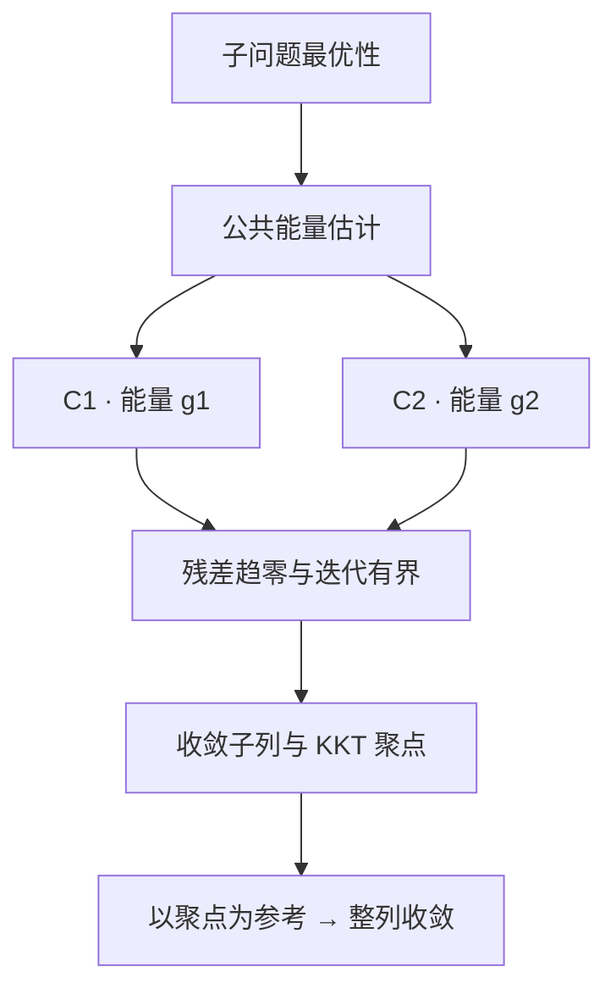

# Adaptive ADMM 的 Lean 形式化

[English](README.en.md) · [数学结论](#数学结论) · [证明框架](#形式化证明框架) · [使用方法](#使用方法) · [源码导览](#源码导览)

本项目使用 Lean 4 证明变罚参数两块 ADMM 的收敛性，包含 C1、C2 两条证明路线，以及供具体罚参数策略复用的证明接口。

## 数学结论

在有限维实内积空间中，考虑

$$
\min_{x_1,x_2}\ f_1(x_1)+f_2(x_2)
\quad\text{s.t.}\quad A_1x_1+A_2x_2=b.
$$

完整收敛定理采用以下假设：

- $f_1,f_2$ 下半连续、凸且处处取有限实数值，并存在 KKT 点。
- 每一步精确求解两个子问题，更新顺序为 $x_1\to x_2\to y$。
- $A_1,A_2$ 都是单射；对矩阵而言，即满列秩。
- $0<\underline\rho\le\rho_n\le\overline\rho<\infty$。
- 乘子松弛参数固定，满足 $0<\tau<(1+\sqrt5)/2$。
- 罚参数变化满足下面的 C1 或 C2 条件。

**结论：存在一个 KKT 点 $(x_1^*,x_2^*,y^*)$，使 $x_1^n\to x_1^*$、$x_2^n\to x_2^*$、$y^n\to y^*$。**

| 路线 | 对罚参数的要求 | 收敛定理 |
| --- | --- | --- |
| C1 | 相对增大量 $\eta_n^2$ 可求和，且相应乘积收敛并有有限上界 | [`adaptive_admm_convergence_c1`](Optlib/Algorithm/AdaptiveADMM/AdaptiveTheorem_converge_c1.lean) |
| C2 | 相对减小量 $\theta_n^2$ 可求和，且相应乘积收敛并有有限上界 | [`adaptive_admm_convergence`](Optlib/Algorithm/AdaptiveADMM/AdaptiveTheorem_converge_c2.lean) |

两个定理均位于命名空间 `AdaptiveADMM_Convergence_Proof`。C1/C2 的精确定义及使用的能量见下方展开内容。

## 形式化证明框架

两条路线共用子问题最优性和能量估计，再分别处理罚参数变化，最后得到整列收敛。



1. **建立公共能量估计。** 将精确子问题解转为次梯度包含关系，再利用次梯度单调性、乘子更新和交叉项估计得到下降不等式。这一步尚不需要 C1/C2。源码：[最优性](Optlib/Algorithm/AdaptiveADMM/AdaptiveOptimality.lean)、[恒等式](Optlib/Algorithm/AdaptiveADMM/AdaptiveEnergyIdentities.lean)、[能量下降](Optlib/Algorithm/AdaptiveADMM/AdaptiveEnergyDescent.lean)。
2. **证明残差趋零和迭代有界。** C1 使用能量 `g1`，C2 使用 `g2`。罚参数的变化条件控制能量增长；下降量可求和给出残差趋零。结合罚参数上下界和 $A_1,A_2$ 的单射性，得到原变量与乘子有界。源码：[C1 条件](Optlib/Algorithm/AdaptiveADMM/AdaptiveCondition1.lean)、[C2 条件](Optlib/Algorithm/AdaptiveADMM/AdaptiveCondition2.lean)、[C1 有界性](Optlib/Algorithm/AdaptiveADMM/BoundednessC1.lean)、[C2 有界性](Optlib/Algorithm/AdaptiveADMM/BoundednessC2.lean)。
3. **构造 KKT 聚点。** 有限维紧性给出共同收敛子列；残差趋零给出极限点的可行性，次梯度图的闭性给出其余 KKT 条件。源码：[C1 聚点](Optlib/Algorithm/AdaptiveADMM/ClusterPointC1.lean)、[C2 聚点](Optlib/Algorithm/AdaptiveADMM/ClusterPointC2.lean)。
4. **从子列收敛推进到整列收敛。** 保留同一子列，以得到的 `limitKKT` 重定义误差和能量。归一化能量非负、最终非增，并有趋零子列，因此整列趋零；再由单射线性映射的逆向范数界还原各变量的收敛。公共标量引理见 [`SequenceConvergence.lean`](Optlib/Algorithm/AdaptiveADMM/SequenceConvergence.lean)，最终定理见上表。

最初传入的 KKT 参考点只用于启动估计。最终极限由收敛子列确定，不必等于这个初始参考点。

<details>
<summary>展开：C1/C2 的定义、能量与关键不等式</summary>

**迭代与误差。** 两个子问题都使用 $\rho_{n+1}$，第二个使用刚更新的 $x_1^{n+1}$。记

$$
r_n=A_1x_1^n+A_2x_2^n-b,
\qquad y^{n+1}=y^n+\tau\rho_{n+1}r_{n+1}.
$$

相对于 KKT 参考点 $(\bar x_1,\bar x_2,\bar y)$，令 $e_{i,n}=x_i^n-\bar x_i$、$e_{y,n}=y^n-\bar y$。[能量定义](Optlib/Algorithm/AdaptiveADMM/AdaptiveDefinitions.lean)为

$$
\begin{aligned}
T&=2-\tfrac12(1+\tau-\tau^2),\\
g_{1,n}&=\|e_{y,n}\|^2+\tau\rho_n^2\|A_2e_{2,n}\|^2
         +\tau(T-\tau)\rho_n^2\|r_n\|^2,\\
g_{2,n}&=\rho_n^{-2}g_{1,n}.
\end{aligned}
$$

**罚参数变化。** 令 $[t]_+=\max\{t,0\}$。对 $n\ge1$，

$$
\eta_n^2=[(\rho_{n+1}/\rho_n)^2-1]_+,
\qquad \theta_n^2=[(\rho_n/\rho_{n+1})^2-1]_+.
$$

代码令 $\eta_0=0$，$\theta_0$ 仍按上式定义。`Condition_C1 admm` 要求 $\sum_n\eta_n^2<\infty$；`Condition_C2 admm` 要求 $\sum_n\theta_n^2<\infty$。两个接口还显式保存相应无穷乘积 $\prod_n(1+\eta_n^2)$ 或 $\prod_n(1+\theta_n^2)$ 的收敛性及有限上界。这些条件均只依赖罚参数序列。

**下降不等式。** 令

$$
D_{n+1}=\|r_{n+1}\|^2+\|A_2(x_2^{n+1}-x_2^n)\|^2,
\qquad c=\tfrac13\tau(1+\tau-\tau^2)>0.
$$

公共定理 `HWY_Theorem_3_1` 分别导出 `HWY_ineq_51` 和 `HWY_ineq_56_0'`：对 $n\ge1$，

$$
\begin{aligned}
g_{1,n+1}+c\rho_{n+1}^2D_{n+1}&\le(1+\eta_n^2)g_{1,n},\\
g_{2,n+1}+cD_{n+1}&\le(1+\theta_n^2)g_{2,n}.
\end{aligned}
$$

由能量有界性、下降量可求和及罚参数的正下界，得到 $r_n\to0$ 和 $A_2(x_2^{n+1}-x_2^n)\to0$，对应 `HWY_Convergence_1`、`HWY_Convergence_2`。

**整列收敛。** 以 KKT 聚点为参考，令 $E_n$ 为相应能量，$a_n$ 为 $\eta_n^2$ 或 $\theta_n^2$。定义

$$
Q_n=\prod_{k=0}^{n-1}(1+a_k),\qquad \widehat E_n=E_n/Q_n.
$$

$Q_n$ 收敛到有限正数，$\widehat E_n$ 非负且从 $n=1$ 起非增。由于它在选定子列上趋零，`tendsto_zero_of_antitone_tail_of_subseq` 给出 $\widehat E_n\to0$，继而 $E_n\to0$。由此得到 $e_{y,n}\to0$ 和 $A_2e_{2,n}\to0$；再利用 $A_1e_{1,n}=r_n-A_2e_{2,n}$ 及单射性得到两个原变量的误差趋零。

</details>

## 使用方法

### 构建与导入

Lean 和 mathlib 均固定为 `v4.24.0-rc1`。安装 elan 后，在项目根目录运行：

```bash
lake exe cache get
lake build
```

默认构建包含 Adaptive ADMM 的统一入口、全部相关证明模块及其数学依赖。证明文件导入：

```lean
import Optlib.Algorithm.AdaptiveADMM
```

检查自己的证明文件：

```bash
lake env lean -E hasSorry -DautoImplicit=false -DrelaxedAutoImplicit=false MyProof.lean
```

### 套用策略模板

`KKTPoint admm` 保存原变量、乘子及其 KKT 证明。误差和能量显式接收参考点，例如 `e₁ admm reference n`、`g1 admm reference n`；C1/C2 条件只接收 `admm`。

策略通过非负可求和幅度 $\delta_n$，将每一步罚参数更新写成增大、减小或保持：

$$
\rho_{n+1}\in\{\rho_n(1+\delta_n),\ \rho_n/(1+\delta_n),\ \rho_n\}.
$$

这里的 $\delta_n$ 对应 `policy.tau.seq`，与固定的乘子松弛参数 $\tau$ 不同。[策略收敛模块](Optlib/Algorithm/AdaptiveADMM/Strategies/Adaptive_Strategy_Convergence.lean)用 $\eta_n^2\le2\delta_n+\delta_n^2$ 建立 C1，再调用通用收敛定理。提供 `reference`、`policy`、实际递推证明 `h_rho` 和两个单射性证明后，调用形式为：

```lean
Strategy3.converges_from_policy
  (admm := admm) reference policy h_rho fullrank₁ fullrank₂
```

裁剪策略采用沿实际罚参数序列计算的有效调节幅度。具体候选仍需证明参数条件、递推对应关系和问题假设。这里的形式化结论针对实数模型，不自动建立 Python 浮点程序与 Lean 模型的等价性。

继续阅读：[三个证明模板](examples/README.md) · [策略与裁剪接口](Optlib/Algorithm/AdaptiveADMM/Strategies/README.md)。

<details>
<summary>历史接口与导入兼容性</summary>

[`Compatibility.lean`](Optlib/Algorithm/AdaptiveADMM/Compatibility.lean) 保留 `Existance_of_kkt` 和空的 `Setting` 参数。新证明使用 `KKTPoint` 和显式传参，核心证明不依赖 `Setting` 自动选择参考点。

原有单模块导入仍可使用。`Optlib.lean` 属于更广泛的上游算法库，本项目使用 `Optlib.Algorithm.AdaptiveADMM` 入口。

</details>

## 源码导览

| 路径 | 内容 |
| --- | --- |
| [`Optlib/Algorithm/AdaptiveADMM.lean`](Optlib/Algorithm/AdaptiveADMM.lean) | 统一导入入口 |
| [`Optlib/Algorithm/AdaptiveADMM/`](Optlib/Algorithm/AdaptiveADMM/) | 模型、能量估计及 C1/C2 证明；具体文件已链接在证明主线中 |
| [`Optlib/Algorithm/AdaptiveADMM/Strategies/`](Optlib/Algorithm/AdaptiveADMM/Strategies/) | 策略、可求和幅度模板与裁剪 |
| `Optlib/Convex`、`Differential`、`Function`、`Optimality` | 基础数学结果 |
| [`examples/`](examples/) | 三个策略的 Lean 证明模板 |

## 许可证

沿用上游的 [Apache 2.0 许可证](LICENSE.txt)，并保留源码作者说明。
