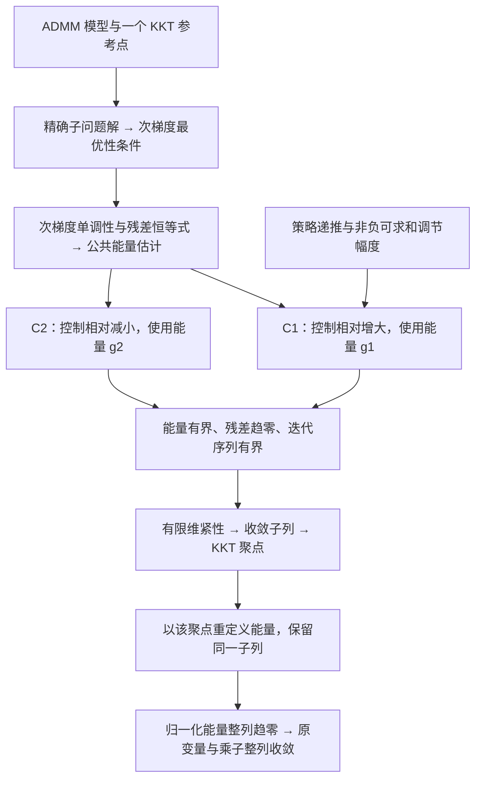

# Adaptive ADMM 的 Lean 形式化

[English](README.en.md)

本项目使用 Lean 4 形式化证明变罚参数两块 ADMM 的收敛性，包含 C1、C2 两条收敛证明，以及可复用的增大、减小、保持罚参数的策略接口。

## 构建与使用

Lean 和 mathlib 均固定为 `v4.24.0-rc1`。安装 elan 后，在本目录运行：

```bash
lake exe cache get
lake build
```

默认构建包含 Adaptive ADMM 的统一入口、全部相关证明模块及其数学依赖。使用时导入：

```lean
import Optlib.Algorithm.AdaptiveADMM

#check KKTPoint
#check AdaptiveADMM_Convergence_Proof.adaptive_admm_convergence_c1
#check AdaptiveADMM_Convergence_Proof.adaptive_admm_convergence
#check Strategy3.converges_from_policy
```

没有后缀的 `adaptive_admm_convergence` 是 C2 定理。原有的单模块导入路径仍可使用。`Optlib.lean` 属于更广泛的上游算法库，本项目使用上面的 Adaptive ADMM 入口。

检查自己的证明文件：

```bash
lake env lean -E hasSorry -DautoImplicit=false -DrelaxedAutoImplicit=false MyProof.lean
```

## 证明的问题与条件

考虑有限维实内积空间中的凸优化问题：

```text
minimize    f₁(x₁) + f₂(x₂)
subject to  A₁ x₁ + A₂ x₂ = b
```

完整收敛定理使用以下条件：

- 两个目标函数下半连续、凸且处处取有限实数值，并存在 KKT 点。
- 每一步都精确求解两个 ADMM 子问题。
- `A₁`、`A₂` 都是单射；对矩阵而言，对应满列秩。
- 罚参数序列具有有限上界和严格正的下界。
- 乘子更新使用固定松弛参数 `0 < τ < (1 + sqrt 5) / 2`。
- 罚参数的相对变化满足 C1 或 C2 条件。

定理证明两个原变量序列和乘子序列收敛到同一个 KKT 点的对应分量。

`Strategy3.converges_from_policy` 根据非负、可求和的调节幅度，以及增大、减小、保持三类实际递推，建立 C1 并应用收敛定理。裁剪策略使用沿实际罚参数序列计算的有效调节幅度。具体候选仍需证明参数条件、递推对应关系和问题假设；这些结果不会自动证明任意 Python 浮点程序与 Lean 模型等价。

## 形式化证明框架

证明分为公共能量估计、C1/C2 条件下的收敛分析、具体策略接入三个部分。下图表示数学论证的依赖关系；各模块均在上面的模型假设下使用。



### 1. 从迭代格式得到能量估计

[`AdaptiveScheme.lean`](Optlib/Algorithm/AdaptiveADMM/AdaptiveScheme.lean) 中的更新顺序为 $x_1^{n+1}$、$x_2^{n+1}$、$y^{n+1}$。两个子问题都使用 $\rho_{n+1}$；第二个子问题使用刚更新的 $x_1^{n+1}$，乘子满足

$$
r_n=A_1x_1^n+A_2x_2^n-b,
\qquad y^{n+1}=y^n+\tau\rho_{n+1}r_{n+1}.
$$

固定一个 `reference : KKTPoint admm`，记其分量为 $(\bar x_1,\bar x_2,\bar y)$，并令 $e_{i,n}=x_i^n-\bar x_i$、$e_{y,n}=y^n-\bar y$。[`AdaptiveDefinitions.lean`](Optlib/Algorithm/AdaptiveADMM/AdaptiveDefinitions.lean) 定义两种能量：

$$
\begin{aligned}
T&=2-\tfrac12(1+\tau-\tau^2),\\
g_{1,n}&=\|e_{y,n}\|^2+\tau\rho_n^2\|A_2e_{2,n}\|^2
         +\tau(T-\tau)\rho_n^2\|r_n\|^2,\\
g_{2,n}&=\rho_n^{-2}g_{1,n}.
\end{aligned}
$$

[`AdaptiveOptimality.lean`](Optlib/Algorithm/AdaptiveADMM/AdaptiveOptimality.lean) 将精确最小化转为次梯度包含关系；[`AdaptiveEnergyIdentities.lean`](Optlib/Algorithm/AdaptiveADMM/AdaptiveEnergyIdentities.lean) 和 [`AdaptiveEnergyDescent.lean`](Optlib/Algorithm/AdaptiveADMM/AdaptiveEnergyDescent.lean) 利用次梯度单调性、乘子更新和交叉项估计，得到公共下降定理 `HWY_Theorem_3_1`。这一部分尚不需要 C1 或 C2。

### 2. C1 与 C2 分别控制哪种变化

令 $[t]_+=\max\{t,0\}$。对 $n\ge1$，两条路线的区别为：

| 路线 | 罚参数变化量 | 使用的能量 | Lean 条件 |
| --- | --- | --- | --- |
| C1 | $\eta_n^2=[(\rho_{n+1}/\rho_n)^2-1]_+$，控制相对增大 | $g_{1,n}$ | [`Condition_C1`](Optlib/Algorithm/AdaptiveADMM/AdaptiveCondition1.lean) |
| C2 | $\theta_n^2=[(\rho_n/\rho_{n+1})^2-1]_+$，控制相对减小 | $g_{2,n}$ | [`Condition_C2`](Optlib/Algorithm/AdaptiveADMM/AdaptiveCondition2.lean) |

代码令 $\eta_0=0$；$\theta_0$ 仍按上式定义。C1 要求 $\sum_n\eta_n^2<\infty$，C2 要求 $\sum_n\theta_n^2<\infty$；两个 Lean 条件还显式保存相应无穷乘积 $\prod_n(1+\eta_n^2)$ 或 $\prod_n(1+\theta_n^2)$ 的收敛性及有限上界。它们只约束罚参数序列，不依赖所选 KKT 参考点。

记

$$
D_{n+1}=\|r_{n+1}\|^2+\|A_2(x_2^{n+1}-x_2^n)\|^2,
\qquad c=\tfrac13\tau(1+\tau-\tau^2)>0.
$$

公共能量估计分别给出下面两个不等式，均从 $n\ge1$ 开始：

$$
\begin{aligned}
g_{1,n+1}+c\rho_{n+1}^2D_{n+1}&\le(1+\eta_n^2)g_{1,n},\\
g_{2,n+1}+cD_{n+1}&\le(1+\theta_n^2)g_{2,n}.
\end{aligned}
$$

对应结果是 `HWY_ineq_51` 和 `HWY_ineq_56_0'`。由能量有界性、下降量可求和及罚参数的正下界，两条路线都推出 $r_n\to0$ 和 $A_2(x_2^{n+1}-x_2^n)\to0$；源码中的汇总定理为 `HWY_Convergence_1`、`HWY_Convergence_2`。

### 3. 从 KKT 聚点推出整列收敛

1. **取得收敛子列。** [`BoundednessC1.lean`](Optlib/Algorithm/AdaptiveADMM/BoundednessC1.lean) 和 [`BoundednessC2.lean`](Optlib/Algorithm/AdaptiveADMM/BoundednessC2.lean) 结合能量界、罚参数上下界以及 $A_1,A_2$ 的单射性，证明 $(x_1^n,x_2^n,y^n)$ 有界。有限维紧性给出一个共同子列及其极限 $(x_1^*,x_2^*,y^*)$。
2. **证明极限满足 KKT。** [`ClusterPointC1.lean`](Optlib/Algorithm/AdaptiveADMM/ClusterPointC1.lean) 和 [`ClusterPointC2.lean`](Optlib/Algorithm/AdaptiveADMM/ClusterPointC2.lean) 用残差趋零得到可行性，再将子问题次梯度关系沿子列取极限，通过次梯度图的闭性得到 $-A_i^*y^*\in\partial f_i(x_i^*)$。这些结果组成新的 `limitKKT : KKTPoint admm`。
3. **以聚点重新定义能量。** 保留已经选好的子列，将误差参考点改为 `limitKKT`。此时相应能量沿该子列趋零。令 $E_n$ 为这一能量，$a_n$ 为对应的 $\eta_n^2$ 或 $\theta_n^2$，再定义

   $$
   Q_n=\prod_{k=0}^{n-1}(1+a_k),\qquad \widehat E_n=E_n/Q_n.
   $$

   已知 $Q_n$ 收敛到有限正数，而 $\widehat E_n$ 非负、从 $n=1$ 起非增，并有趋零子列。[`SequenceConvergence.lean`](Optlib/Algorithm/AdaptiveADMM/SequenceConvergence.lean) 中的 `tendsto_zero_of_antitone_tail_of_subseq` 因而给出 $\widehat E_n\to0$，继而 $E_n\to0$。
4. **还原各个变量的收敛。** 能量趋零给出 $e_{y,n}\to0$ 和 $A_2e_{2,n}\to0$；由 $A_1e_{1,n}=r_n-A_2e_{2,n}$ 得到 $A_1e_{1,n}\to0$。有限维空间中单射线性映射的逆向范数界再给出 $e_{1,n},e_{2,n}\to0$。

最终得到**存在某个 KKT 点，使两个原变量序列和乘子序列分别收敛到其分量**。初始 `reference` 用于启动估计；定理不要求极限等于这个初始参考点。

| 最终定理（命名空间 `AdaptiveADMM_Convergence_Proof`） | 源码 |
| --- | --- |
| `adaptive_admm_convergence_c1` | [C1 整列收敛](Optlib/Algorithm/AdaptiveADMM/AdaptiveTheorem_converge_c1.lean) |
| `adaptive_admm_convergence` | [C2 整列收敛](Optlib/Algorithm/AdaptiveADMM/AdaptiveTheorem_converge_c2.lean) |

### 4. 具体策略怎样接入证明

策略接口使用非负可求和幅度 $\delta_n$，并证明实际罚参数逐步满足

$$
\rho_{n+1}\in\{\rho_n(1+\delta_n),\ \rho_n/(1+\delta_n),\ \rho_n\}.
$$

这里用 $\delta_n$ 区别于固定的乘子松弛参数 $\tau$；代码中的幅度字段名为 `tau_seq` 或 `policy.tau.seq`。[`Adaptive_Strategy_Convergence.lean`](Optlib/Algorithm/AdaptiveADMM/Strategies/Adaptive_Strategy_Convergence.lean) 先证明 $\eta_n^2\le2\delta_n+\delta_n^2$，再由 $\sum_n\delta_n<\infty$ 建立 C1 的级数和乘积条件，最后调用 `adaptive_admm_convergence_c1`。具体模板因此只需补齐幅度、实际递推和问题假设，无需重复证明后续的有界性与整列收敛。使用示例见[证明模板](examples/README.md)。

## 显式传入 KKT 参考点

`KKTPoint admm` 保存原变量、乘子及其满足 KKT 条件的证明。误差和能量函数直接接收参考点，例如：

```text
e₁ admm reference n
ey admm reference n
g1 admm reference n
```

`Condition_C1 admm`、`Condition_C2 admm` 只描述罚参数条件，不再携带参考点。策略收敛接口的调用形式为：

```lean
Strategy3.converges_from_policy
  (admm := admm) reference policy h_rho fullrank₁ fullrank₂
```

证明先用原始参考点建立有界性并选取子列，再把得到的 `limitKKT` 显式传给最终误差和能量估计。选定的子列保持不变，核心证明不依赖 `Setting` 自动选择参考点。

`Compatibility.lean` 为历史证明保留 `Existance_of_kkt` 和空的 `Setting` 参数。新证明使用 `KKTPoint` 和显式参数；当前三个策略模板也采用这一接口。

## 源码结构

下列路径相对于 `Optlib/Algorithm/AdaptiveADMM/`：

| 模块 | 内容 |
| --- | --- |
| `AdaptiveScheme.lean` | 优化问题、迭代格式、KKT 条件和 `KKTPoint` |
| `AdaptiveDefinitions.lean` | 显式接收参考点的误差、能量及辅助序列 |
| `AdaptiveOptimality.lean` | 子问题凸性、求导和次梯度最优性 |
| `AdaptiveEnergyIdentities.lean` | 残差恒等式和次梯度单调性估计 |
| `AdaptiveEnergyDescent.lean` | 交叉项估计与公共能量下降不等式 |
| `AdaptiveLemmas.lean` | 公共最优性和下降结果的导入入口 |
| `AdaptiveCondition1.lean`、`AdaptiveCondition2.lean` | 罚参数变化、能量有界性和残差趋零 |
| `BoundednessC1.lean`、`BoundednessC2.lean` | 乘积归一化、迭代有界性和子列选取 |
| `ClusterPointC1.lean`、`ClusterPointC2.lean` | 子列极限与 KKT 聚点的构造 |
| `AdaptiveTheorem_converge_c1.lean`、`AdaptiveTheorem_converge_c2.lean` | 以聚点为参考的能量估计和整列收敛 |
| `SequenceConvergence.lean` | 从趋零子列推出整列趋零的公共标量引理 |
| `AdaptiveProductBounds.lean`、`AdaptiveInv_bounded.lean` | 乘积估计和单射线性映射的逆向界 |
| `Strategies.lean`、`Strategies/` | 策略接口、可求和调节序列、裁剪及 C1 连接 |

`Optlib/Convex`、`Optlib/Differential`、`Optlib/Function` 和 `Optlib/Optimality` 提供所需的基础数学结果。策略接口的详细说明见[策略指南](Optlib/Algorithm/AdaptiveADMM/Strategies/README.md)。

## 许可证

沿用上游的 [Apache 2.0 许可证](LICENSE.txt)，并保留源码作者说明。
